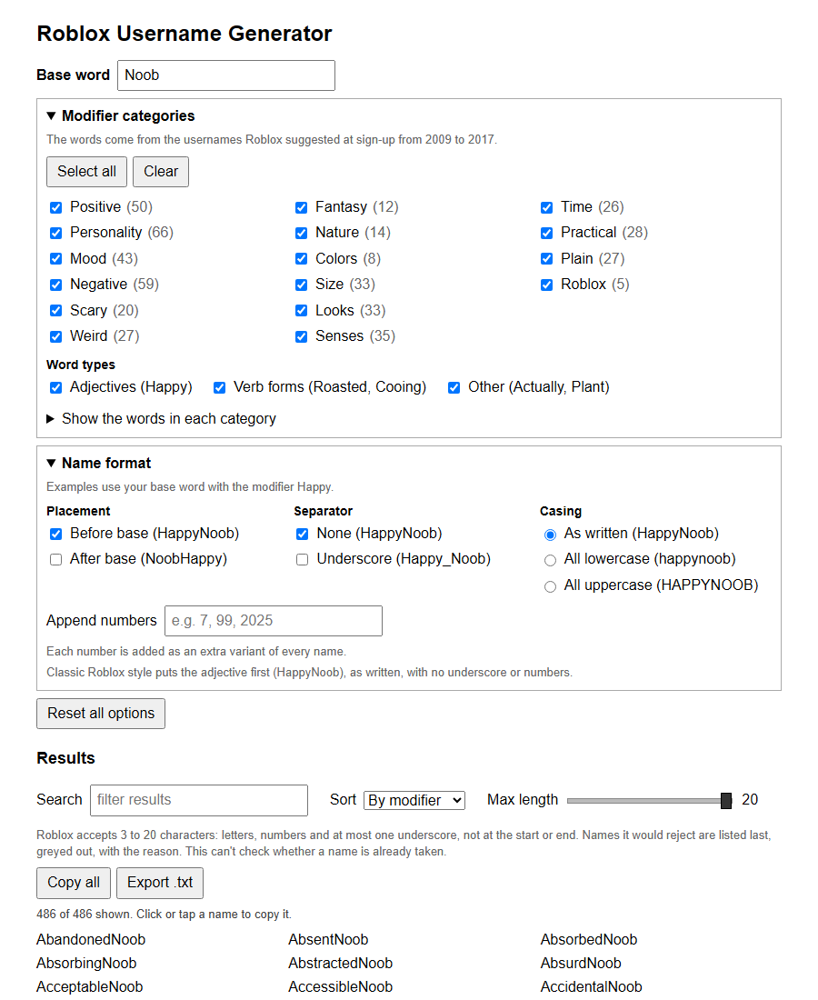
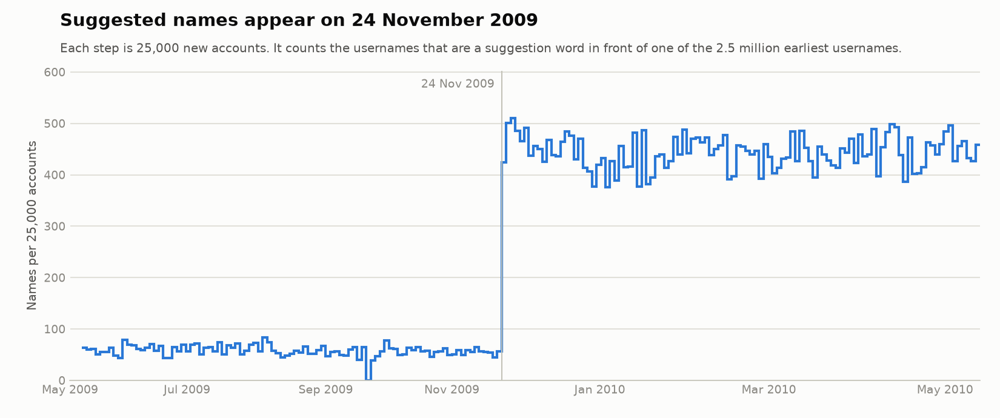

# Roblox Username Generator

A small page that puts an old Roblox adjective in front of a word and lists the usernames that come out. Type `Noob` and you get `AnimatedNoob`, `GloriousNoob`, `WhimsicalNoob` and a few hundred more.

From 2009 to 2017, Roblox suggested names like these whenever the username you wanted was taken. This page makes names in the same style, using the same adjectives.

## Try it

Open it at **[vinevard.github.io/roblox-username-generator](https://vinevard.github.io/roblox-username-generator/)**.

Or download `index.html` and open it in a browser. It is one file with no build step, and it makes no network requests.

## What it does

- Combines your word with 486 adjectives, grouped into 16 categories you can switch on and off.
- Greys out the names Roblox would reject and shows the reason beside each one. You can hide them.
- Can put the adjective after the word, add an underscore, change the case, or add numbers.
- Lets you search, sort and shuffle the names, and set a maximum length.
- Copies a name when you click or tap it. You can also copy or save the whole list.
- Remembers your settings for next time.

It checks Roblox's naming rules: 3 to 20 characters, only letters, numbers and underscores, and at most one underscore that is not at the start or end. It can't tell you whether a name is already taken.

## Where the words come from

Roblox never published the adjectives it used. They can still be worked out from a public list of Roblox usernames. People who took a suggestion ended up with names like `DramaticTelamon`, and names like that all start appearing on the same day, 24 November 2009.

If you are curious how that works, [the write-up](research/README.md) goes through it step by step and includes the scripts. It might also be useful as a small example of finding a pattern in a large text file.

The words are in [`suggestion-words.txt`](suggestion-words.txt). The usernames come from an [archive collected by shy](https://blog.shy.rocks/p/scraping-roblox-users/).

## License

[MIT](LICENSE). This project is not affiliated with Roblox Corporation.
