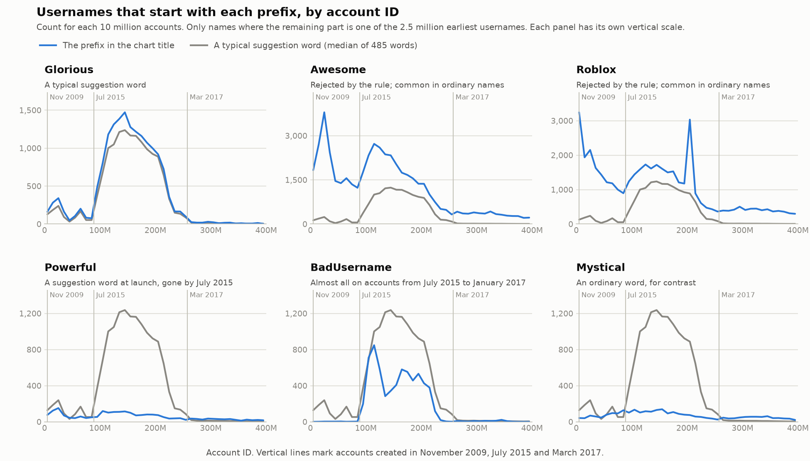
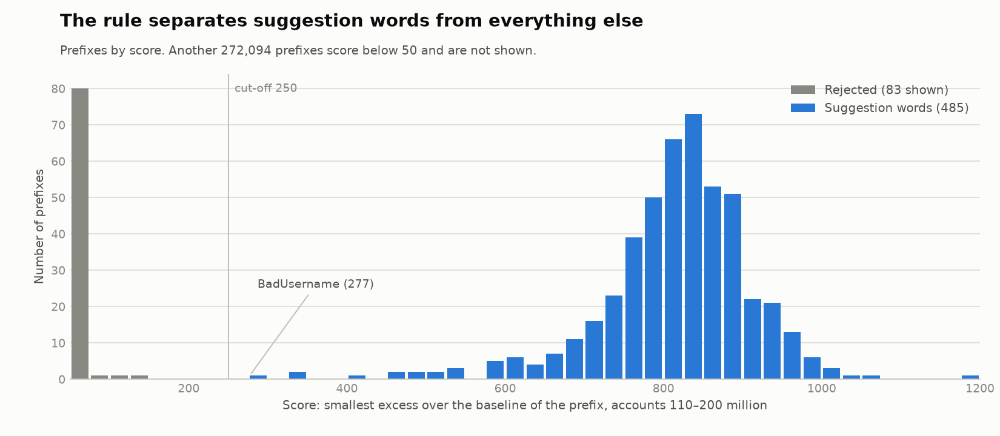
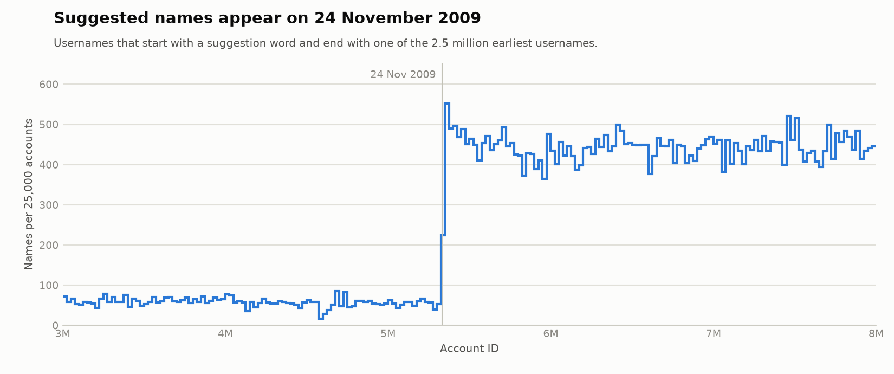

# Recovering Roblox's username-suggestion words from account names

From late 2009 to early 2017, if you tried to sign up to Roblox with a username that was taken, the site offered you the same name with an adjective in front. Ask for `Noob` and you might get `AnimatedNoob`. Roblox never published the adjectives it drew from, and as far as we can tell they were never sent to the browser, so no archived copy of the sign-up page contains them.

They are recoverable anyway, because a lot of people took the suggestion. This folder shows how to pull the words out of a public dump of Roblox usernames without starting from a word list.



## Summary

- One rule applied to prefix counts recovers 485 suggestion words. On the rule's score, 96% of them are above 600, and apart from `BadUsername` no other prefix is above 139.
- Suggested names first appear on 24 November 2009, around account 5,334,300. They fall back to the background level with accounts created around 8 March 2017.
- Suggested names became far more common from 13 July 2015, and again from 18 November 2015, but the words stayed the same. We found no second list.
- One word, `Powerful`, was a suggestion at the start and was dropped at some point before July 2015.
- `BadUsername` passes the rule but is not an adjective, and nearly all of it is on accounts created between July 2015 and January 2017. We think Roblox gave it to accounts whose usernames were removed by moderation.

That makes 486 suggestion words in all: 485 that Roblox used until 2017, and Powerful, which it dropped before July 2015. The tool uses all of them, and the full list is in [`suggestion-words.txt`](../suggestion-words.txt).

## Background

The suggestion came from a server-side call. The Wayback Machine has Roblox's `UserCheck.asmx` service page listing a `GetRecommendedUsername(usernameToTry)` operation, and [a capture from 7 April 2017](https://web.archive.org/web/20170407132914/http://www.roblox.com:80/UserCheck/GetRecommendedUsername?usernameToTry=Merely) of the endpoint itself, returning a name with an adjective in front. That single response is the only direct evidence we have of a suggested name.

Everyone who took a suggestion ended up with a username made of an adjective followed by the name they wanted, and the name they wanted already belonged to someone else. So the adjectives appear in front of older usernames, and only during the years Roblox was suggesting them.

## Data

We used ["the first 6 billion roblox users"](https://archive.org/details/rbx-users-6b.7z), a dump of `id:username` lines collected by walking account IDs upward ([write-up by its author](https://blog.shy.rocks/p/scraping-roblox-users/)). Account IDs are assigned in order, so position in the file is a timeline. We looked up a handful of IDs on Roblox's public users API to attach dates:

| Account ID | Created |
|---|---|
| 5.334 million | 24 Nov 2009 |
| 30 million | 18 Jul 2012 |
| 89 million | 13 Jul 2015 |
| 99 million | 18 Nov 2015 |
| 110 million | 18 Feb 2016 |
| 222.5 million | 24 Jan 2017 |
| 258 million | 8 Mar 2017 |

The archive is a single 47.7 GB LZMA2 stream, so the front of it can be read without the rest. We downloaded the first 8.86 GB, which covers accounts 1 to 1,087,398,914. The last of those was created on 21 May 2019.

## Method

**1. Count prefixes.** Take the usernames of the first 2.57 million accounts (those with at least four characters that are not all digits, about 2.5 million names) as a stand-in for "names somebody might have wanted and found taken". For every username that starts with a capital letter, try each split into a 3–14 letter prefix and a remainder, and keep the split when the remainder (lower-cased) is one of those early names. Tally each prefix per 10 million account IDs. This step uses no word list.

**2. Apply one rule.** Ordinary prefixes such as `The`, `Super` or `Dark` are in use all the time. A suggestion word is common only while Roblox is suggesting it. Suggestions peak for accounts 110–200 million (February to December 2016), so for each prefix:

- work out a baseline, the higher of its mean count in accounts 40–90 million and its mean count in accounts 300–400 million
- subtract the baseline from its count for each 10 million accounts between 110 and 200 million
- take the smallest of those differences as its score
- keep the prefix if the score is at least 250

Only prefixes made entirely of letters, starting with a capital and not written in all capitals are considered. All-caps versions of suggestion words (`FAST`, `LUCKY`, `SPOOKY`) turn up in the data too, starting at the same point in 2009, presumably because the service copied the capitalisation of the name typed. They are the same words, so we skip them.

`derive_list.py` does this and writes [`derived-words.txt`](derived-words.txt).

**3. Look at the start.** Recount prefixes in bins of 250,000 accounts over the first 30 million. This dates the start of the feature and catches words that Roblox retired before 2016, which step 2 cannot see. A prefix counts as starting with the feature if it occurs at least 20 times in accounts 5.5–7.5 million, and at least eight times as often as in accounts 3.25–5.25 million (counted as one more than it is, so that a count of zero does not let everything through). Any capitalised word that passes this test but is missing from the step 2 list may be a retired word. `launch_detail.py` then counts suggested names in bins of 5,000 accounts and lists the usernames around the start, which gives the exact day.

## Results

### The word list

The rule keeps 486 prefixes: 485 words and `BadUsername`. The raw output is in [`derived-words.txt`](derived-words.txt); the final list, without `BadUsername` and with Powerful added, is [`suggestion-words.txt`](../suggestion-words.txt). A random sample:

> Alike, Animated, Apathetic, Astonishing, Available, Average, Better, Black, Broken, Capable, Ceaseless, Cowardly, Damaging, Earthy, Efficient, Entertaining, Gorgeous, Hesitant, Icky, Ignorant, Itchy, Jittery, Jumpy, Majestic, Moldy, Needy, Noisy, Numerous, Observant, Obsolete, Plant, Pleasant, Puffy, TimLike, Tough, Whimsical

Most are ordinary adjectives. A few are not adjectives at all (`Plant`, `Quack`, `Actually`, `Madly`), and a few are in-jokes (`TimLike`, see below).

The cut-off of 250 could be moved a long way without changing the result. Anywhere from 150 to 250 gives the same 486. At 300, one word and `BadUsername` drop out. At 100, two non-words (`Itz`, `Kawaii`) get in. The lowest-scoring word scores 291.

Splitting names mechanically also produces cut-off words such as `Fearles` and `Nervou`, because `Fearles` + `steve` is as valid a split as `Fearless` + `teve`. These score below 80, so the rule rejects them.



The histogram shows the score of every prefix that reaches 50. The 485 words sit in one cluster centred near 830, and the nearest rejected prefix is at 139. The scores are in [`scores.csv`](scores.csv).

### Timeline

| Accounts | Dates | What happens |
|---|---|---|
| below 5.334M | to 24 Nov 2009 | No suggested names. |
| 5.334M | 24 Nov 2009 | Suggested names start appearing. Names beginning with a suggestion word go from about 55 to about 440 per 25,000 accounts. |
| 5.334M–89M | Nov 2009 – Jul 2015 | Steady use, lower after mid-2012. |
| 89M | 13 Jul 2015 | Roughly a fourfold jump. |
| 99M | 18 Nov 2015 | A second jump, then a climb through 2016. |
| 222M–227M | 24–30 Jan 2017 | Sharp drop. |
| 258M | 8 Mar 2017 | Back to the level before July 2015. |



The low, flat level before the start is ordinary usernames that happen to begin with one of the words. The values are in [`launch.csv`](launch.csv).

The first run of suggested names begins around account 5,334,300, created at about 02:00 UTC on 24 November 2009. Several of the first ones are built on staff and site names, such as `DramaticTelamon`, which looks like people at Roblox trying the feature out.

The same words appear before and after both jumps in 2015. What changed was how many new accounts ended up with a suggested name. Neither jump lines up with Roblox's arrival on Xbox One, which [launched on 27 January 2016](https://www.prnewswire.com/news-releases/worlds-largest-user-generated-gaming-destination-now-available-on-xbox-300210481.html), around account 107 million. Counts are already climbing by then and show no separate step at that point. We have no explanation for either jump.

The suggested names put the adjective first. In a separate sample of about 18,000 accounts drawn through Roblox's public API, names ending in a suggestion word were no more common than chance.

### Powerful

The test in step 3 passes 402 capitalised prefixes. 396 of them are words already found by step 2. Of the other six, four are cut-off words (`Fearles`, `Damage`, `Dynami`, `Vas`), one is an unrelated name that appears briefly, and one is `Powerful`.

`Powerful` starts on 24 November 2009 with all the other words. Up to account 30 million (July 2012) it runs steadily at about 0.6 times the rate of a typical suggestion word. From account 90 million (July 2015) it is at about a tenth of a typical suggestion word, and it does not rise with the others in 2015 and 2016, so Roblox had removed it by then. We can't date the removal more closely. `Powerful` is also a fairly common ordinary prefix, and from 2012 to mid-2015 a typical suggestion word was running at a similar level. It is the only retired word frequent enough for us to detect.

### BadUsername

`BadUsername` passes the rule with a score of 277, but it is not an adjective, and it behaves differently from every suggestion word. It is almost absent before account 89 million, with fewer than five occurrences per 10 million accounts. Nearly all of it is on accounts created between July 2015 and January 2017, which overlaps the 2016 window the rule looks at.

We left it out of the final list. Our guess is that Roblox gave this name to accounts whose usernames were removed by moderation. The data cannot confirm that.

### Awesome and Roblox

`Awesome` and `Roblox` could be mistaken for suggestion words, because both rise during 2015–2017. The rule rejects them, and they are not in the final list.

A suggestion word such as `Glorious` is almost unused before November 2009, common while Roblox was suggesting it, and almost unused again after March 2017. `Awesome` and `Roblox` do not look like that. Both are common in the earliest accounts, before the feature existed, and both stay well above zero after March 2017. They are very common ways to start an ordinary username.

The first figure shows the rise during 2015–2017. We have not found its cause.

### The staff names

The list contains `SamLike`, `TimLike`, `VibhuLike` and `TelamonLike`, where "Like" turns a name into an adjective. Telamon was the old username of John Shedletsky, and Sam, Tim and Vibhu match engineers who worked at Roblox during 2009 and 2010 (RobloSam, RobloTim and Vibhu Norby), which is when the feature appears. `Roblo`, also on the list, aligns with staff usernames of that time. All of these behave like every other suggestion word in the data.

## The timeline figure

Each panel of the figure at the top of this page plots one prefix (blue) against the median of the 485 suggestion words (grey), per 10 million accounts, with markers at November 2009, July 2015 and March 2017. Each panel has its own vertical scale, so only the shapes of the lines can be compared between panels. The numbers are in [`timeline.csv`](timeline.csv).

- **Glorious** is a typical suggestion word.
- **Awesome** and **Roblox** are common ordinary prefixes that the rule rejects.
- **Powerful** follows the suggestion words at first and is gone by July 2015.
- **BadUsername** is almost entirely on accounts created between July 2015 and January 2017.
- **Mystical** is an ordinary word, shown for contrast.

## Reproducing

You need Python 3 and about 10 GB of disk. Everything except the plots uses only the standard library; the plots need matplotlib. From the repository root:

```
mkdir data
python research/download_prefix.py data/rbx-users-6b.part 8860000000
python research/analyze.py data/rbx-users-6b.part suggestion-words.txt data/bands.json 60000000
python research/profile_all.py data/rbx-users-6b.part data/bands.json.base data/profile.json
python research/derive_list.py data/profile.json data/derived-words.txt
python research/blind_discovery.py data/rbx-users-6b.part data/bands.json.base data/blind.json 4000000 6000000 30000000
python research/plot_timeline.py data/profile.json data/derived-words.txt data/timeline.png data/timeline.csv
python research/plot_scores.py data/profile.json data/scores.png data/scores.csv
python research/launch_detail.py data/rbx-users-6b.part data/bands.json.base suggestion-words.txt data/launch.json
python research/plot_launch.py data/launch.json data/launch.png data/launch.csv
```

| Script | What it does |
|---|---|
| `download_prefix.py` | Fetches the first N bytes of the archive with parallel range requests. |
| `analyze.py` | Writes the early-names file (`bands.json.base`) the other scripts need, and counts a given word list per 5 million accounts. |
| `profile_all.py` | Step 1. Prefix counts over the whole range. About 15 minutes; saves as it goes. |
| `derive_list.py` | Step 2. Applies the rule. |
| `blind_discovery.py` | Step 3. Prefix counts around the start of the feature in bins of 250,000. |
| `plot_timeline.py` | Draws the timeline figure. |
| `plot_scores.py` | Draws the histogram of rule scores. |
| `launch_detail.py` | Counts suggested names in bins of 5,000 accounts up to account 8 million, and lists the usernames around the start. |
| `plot_launch.py` | Draws the chart of the start of the feature. |
| `chart_style.py` | Colours and axis styling shared by the three plotting scripts. |
| `examples_and_fine_bins.py` | Pulls example usernames for chosen prefixes and per-million counts around the 2015 and 2017 changes. |

We ran these commands as printed and they reproduce the shipped files exactly: the same `derived-words.txt` and the same values behind all three charts. The one shortcut was the download, where we re-fetched and compared only the first 50 MB, since the full 8.86 GB was already on disk.

## Limitations

- **Counts are underestimates.** A suggestion is only counted when the wanted name belongs to one of the first 2.57 million accounts. Real numbers are higher, especially in later years.
- **The rule only finds words in use in 2016.** Step 3 catches earlier retirements, and only if the word was common enough. There may be other words like Powerful that we missed.
- **What `BadUsername` was for is a guess.**
- **We can't explain the two 2015 jumps**, or why `Awesome` and `Roblox` rise over the same period.

## Credits

The username archive was collected and published by [shy](https://blog.shy.rocks/p/scraping-roblox-users/). This project is not affiliated with Roblox Corporation, and nothing here comes from Roblox's code or internal data.
